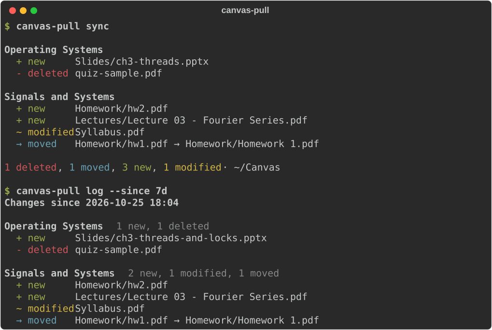

<h1 align="center">Canvas Pull</h1>

<p align="center">
  <b>Keep a local copy of your Canvas course files, and see exactly what changed.</b>
</p>

<p align="center">
  <a href="https://github.com/gxxxr-111/canvas-pull/actions/workflows/ci.yml"></a>
  <a href="https://pypi.org/project/canvas-pull/"></a>
  <a href="https://pypi.org/project/canvas-pull/"></a>
  <a href="LICENSE"></a>
</p>

<p align="center">
  <a href="#quick-start">Quick start</a> ·
  <a href="#commands">Commands</a> ·
  <a href="#faq">FAQ</a> ·
  <a href="#中文说明">中文说明</a>
</p>

canvas-pull downloads the files of your Canvas LMS courses with one command. Every later run
downloads only what changed and tells you which files your instructors **added, modified,
renamed/moved or deleted**. It can run on its own every morning and notify you.

<p align="center">
  
</p>

## Features

- **Incremental sync.** Files are tracked by their Canvas file ID, so unchanged files are never
  downloaded again and renames are detected without re-downloading.
- **Change report.** `status` previews changes, `sync` applies them, `log` shows past syncs,
  and `log --since 7d` gives a merged weekly summary.
- **Automatic sync.** `schedule enable` runs a sync every day (or every few hours) and shows a
  desktop notification when something changes.
- **Old versions kept.** When a file changes, the previous copy is moved to
  `.canvas-pull/history/<timestamp>/`. Files deleted on Canvas stay on your disk.
- **Files tab by default, more on request.** Only the Files tab is synced by default (with
  Modules as a fallback when a course hides it). Opt in to the syllabus, assignment
  descriptions, pages, announcements and discussions through the `sources` setting.
- **Current courses, or everything.** Courses whose term has ended are skipped by default;
  `--completed` also archives concluded courses. A completed course is scanned once; later syncs
  skip it (use `--refresh` to scan it again).
- **Safe token storage.** `init` stores your token in the system keychain, not in a text file.
- **Optional git.** `sync --git` commits each sync in the save folder.
- **Read-only and private.** Only reads from Canvas; no telemetry, nothing leaves your machine.
- **Fast.** Courses are scanned in parallel (a 32-course account scans in about 10 s instead of
  75 s), with parallel downloads, automatic retries with back-off and full pagination.

## Install

```bash
uv tool install canvas-pull     # or: pipx install canvas-pull
```

Try it without installing: `uvx canvas-pull --help`. Python 3.11+ on macOS, Linux or Windows.
To get the latest unreleased code: `uv tool install git+https://github.com/gxxxr-111/canvas-pull`.

## Quick start

1. In Canvas, open **Account → Settings → New Access Token** and copy the token.
   Give it an expiry date. Never share it.
2. Run:

   ```bash
   canvas-pull init      # Canvas URL (e.g. oc.sjtu.edu.cn), save folder, token
   canvas-pull courses   # check which courses will be synced
   canvas-pull sync
   ```

## Commands

| Command | What it does |
| --- | --- |
| `canvas-pull init` | Set Canvas URL, save folder and token (token goes to the keychain). |
| `canvas-pull courses [--all] [--completed]` | List courses that would be synced. |
| `canvas-pull status [-c COURSE] [--completed]` | Show what changed on Canvas. Downloads nothing. |
| `canvas-pull sync [-n] [-c COURSE] [--completed] [--refresh] [--git] [--notify]` | Download changes. `-n` is a dry run. `-c` takes a course ID or part of its name and can be repeated. `--refresh` rescans archived completed courses. `--notify` shows a desktop notification. |
| `canvas-pull log [-n 10]` | Show recent syncs. |
| `canvas-pull log --since 7d` | Merged summary since `7d`, `24h`, `2w`, `today` or a date. |
| `canvas-pull schedule enable [--at 08:00 ...] [--every 6h]` | Sync automatically (launchd on macOS, systemd timer on Linux). Default: daily 09:00. |
| `canvas-pull schedule status \| run \| disable` | Show the schedule and its log, trigger it now, or remove it. |
| `canvas-pull config` | Show settings in use. |

## Configuration

`init` writes a config file (path shown by `canvas-pull config`). You can edit it:

```toml
website = "https://oc.sjtu.edu.cn"
save_dir = "/Users/me/Canvas"
concurrency = 4          # parallel downloads
scan_concurrency = 8     # parallel API requests while scanning (max 16)
keep_history = true      # keep replaced versions in .canvas-pull/history
git = false              # commit after every sync
exclude = ["PE", "12345"] # course IDs or name fragments to skip
include_completed = false # also sync concluded courses
sources = ["files"]       # default; add any of the sources below
```

Available sources: `files`, `modules`, `syllabus`, `assignments`, `pages`, `announcements`,
`discussions`. With the default, a course that hides its Files tab (or leaves it empty) falls
back to Modules automatically. To grab everything:

```toml
sources = ["files", "modules", "syllabus", "assignments", "pages", "announcements", "discussions"]
```

Environment variables override the file: `CANVAS_URL`, `CANVAS_TOKEN`, `CANVAS_SAVE_DIR`. A
`.env` file in the current folder is also read (v1 keys `WEBSITE`, `ACCESS_TOKEN`, `SAVE_DIR`
still work).

When a file appears in several places it keeps the path of the first source in that list, so a
file in the Files tab stays where it is even if an assignment links to it. Files found elsewhere
go under `Modules/<module>/`, `Assignments/<name>/`, `Pages/<title>/`, `Announcements/<title>/`,
`Discussions/<title>/` or `Syllabus/`.

### Automatic sync

```bash
canvas-pull schedule enable --at 08:00 --at 20:00   # or: --every 6h
canvas-pull schedule run      # try it once now
canvas-pull schedule status   # schedule + last log lines
```

The job runs `canvas-pull sync --notify` from the folder where you enabled it. A Mac that was
asleep at the scheduled time catches up when it wakes. Install with `uv tool install` first so
the job points at a stable path.

On Windows, `schedule` is not available yet: create a daily task in Task Scheduler that runs
`canvas-pull sync`. Desktop notifications are macOS and Linux only for now.

## How change detection works

Each synced file is recorded in `<save_dir>/.canvas-pull/manifest.json` with its Canvas ID,
path, size, last-modified time and SHA-256. On every run canvas-pull compares that record with
Canvas metadata:

| Canvas says | Result |
| --- | --- |
| ID not seen before | **new**: download |
| Size or modified time changed | **modified**: download; if the bytes are identical, nothing is reported |
| Same content, different name/folder | **moved**: renamed locally, no download |
| ID gone from a course that was read successfully | **deleted**: reported once; local copy kept |
| Recorded but missing on disk | **restored**: downloaded again |

Content-level diffs of PDF/PPTX/DOCX are out of scope for now.

## Tested schools

canvas-pull uses the standard Canvas REST API, so it should work with any Canvas site where
students can create access tokens.

| School | Canvas site | Status |
| --- | --- | --- |
| Shanghai Jiao Tong University (上海交通大学) | `oc.sjtu.edu.cn` | ✅ Works |

Tried it at your school? Please open a
[school report](https://github.com/gxxxr-111/canvas-pull/issues/new?template=school_report.yml),
whether it worked or not.

## FAQ

**My school doesn't let students create access tokens.**
That isn't supported yet. Please file a school report so we know which schools need another
sign-in method.

**What does "N locked file(s) not yet available" mean?**
The instructor has locked those files (until a date, or behind a module requirement). They are
downloaded automatically once they unlock.

**Where did the old version of a changed file go?**
To `<save_dir>/.canvas-pull/history/<timestamp>/`, keeping its folder structure. Turn this off
with `keep_history = false`.

**I deleted a downloaded file by accident.**
Run `canvas-pull sync`; it is downloaded again and reported as *restored*.

**Can canvas-pull change anything on Canvas?**
No. It only sends read (`GET`) requests.

**My token expired.**
Create a new one in Canvas and run `canvas-pull init` again. Scheduled syncs show a notification
when the token is rejected.

**How do I skip a course?**
Add its ID or part of its name to `exclude` in the config file (`canvas-pull courses` shows IDs).

## Privacy and security

- The token is kept in the OS keychain and is only sent to your Canvas site. It is not forwarded
  when a download redirects to file storage.
- No telemetry and no third-party services.
- See [SECURITY.md](SECURITY.md) for details and how to report a vulnerability.

## Related projects

Other Canvas download tools you may also like:

- [skyzh/canvas_grab](https://github.com/skyzh/canvas_grab): sync script with a GUI, popular at SJTU.
- [perslev/CanvasSync](https://github.com/perslev/CanvasSync): syncs modules, assignments and files.
- [aik2mlj/canvas-downloader](https://github.com/aik2mlj/canvas-downloader): fast downloader written in Rust.
- [BrkBuilds/Canvas-Downloader](https://github.com/BrkBuilds/Canvas-Downloader): desktop app for Windows and macOS.
- [Beebeeoii/lominus](https://github.com/Beebeeoii/lominus): file sync for NUS Canvas.

canvas-pull focuses on the command line and automation: it tracks files by ID, reports exactly
what changed (including renames), keeps old versions, and can run unattended.

## Contributing

Bug reports, school reports and pull requests are welcome. See
[CONTRIBUTING.md](CONTRIBUTING.md). Tests run against an in-memory fake Canvas, so no account is
needed:

```bash
uv sync && uv run pytest
```

Changes are listed in [CHANGELOG.md](CHANGELOG.md). Licensed under [MIT](LICENSE).

---

## 中文说明

一条命令同步所有**正在进行的** Canvas 课程文件。之后每次运行只下载有变化的文件，并列出老师**新增、修改、改名/移动、删除**了哪些文件。

```bash
uv tool install canvas-pull       # 或 pipx install canvas-pull
canvas-pull init      # 填学校 Canvas 域名（如 oc.sjtu.edu.cn）、保存目录、Access Token
canvas-pull status    # 只看变化，不下载
canvas-pull sync      # 下载变化
canvas-pull log --since 7d          # 本周汇总
canvas-pull schedule enable --at 08:00   # 每天早上自动同步，有变化时弹通知
```

- Token 在 Canvas 的「账户 → 设置 → 新建访问许可证」生成，`init` 会把它存进系统钥匙串。
- 文件被修改时，旧版本会移到 `.canvas-pull/history/`；Canvas 上删除的文件本地不会删除。
- 默认只同步「文件」栏目；课程隐藏了文件栏目时，会自动改从「模块」里找。
- 想要更多来源（课程大纲、作业、页面、公告、讨论里的附件和链接），在配置文件里设置 `sources`。
- `--completed` 可以把已结业的课程也一起归档下来。已结业的课只完整扫描一次，之后自动跳过（`--refresh` 强制重扫）。
- 多门课并行扫描，32 门课大约 10 秒扫完。
- `sync --git` 会在保存目录里自动提交一次 git，方便用 `git log` 回看。
- 只读取 Canvas，不会修改任何内容；没有遥测，数据不离开你的电脑。
- 在你的学校试过了？欢迎提交一个 [School report](https://github.com/gxxxr-111/canvas-pull/issues/new?template=school_report.yml)，无论成功与否。
